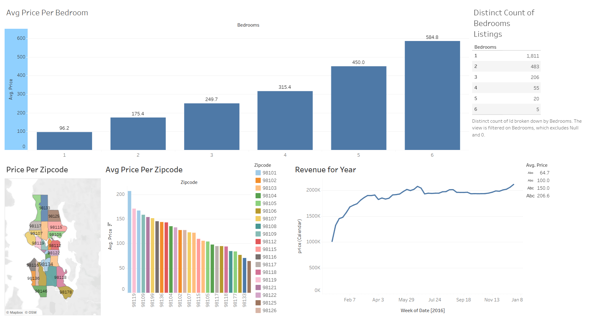

# Seattle Airbnb Pricing Dashboard (Tableau)

## Objective
Analyse Seattle Airbnb listings (2016-2017) to understand how pricing varies by bedroom count and location, and how listed prices change over time.

## Dataset
Seattle Airbnb listings dataset from Kaggle:
https://www.kaggle.com/datasets/alexanderfreberg/airbnb-listings-2016-dataset

## Live dashboard
https://public.tableau.com/app/profile/parinita.bhosale/viz/SeattleAirbnbPricingDashboard/SeattleAirbnbMarketAnalysis20162017

## Dashboard preview

## What the dashboard shows
- Average price per bedroom count
- Number of listings by bedroom count
- Average price by zipcode, as a bar chart and a map
- Price trend over time (weekly total of listed calendar prices)

## Key findings
- Average price rises steadily with size, from about $96 for 1-bedroom listings to about $585 for 6-bedroom listings.
- Small listings dominate the market: about 70% of listings (1,811 of 2,580) are 1-bedroom.
- Average prices vary widely by area, from roughly $65 in the cheapest zipcode to about $200 in the most expensive.
- Listed prices rose sharply in early 2016, then stayed relatively stable through the year.

## Tools
Tableau Public, Microsoft Excel

## Files
- `dashboard_preview.png`: screenshot of the dashboard
